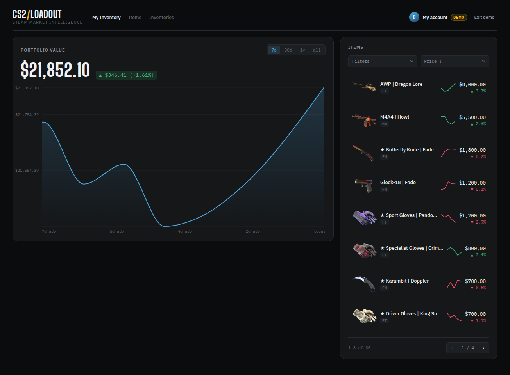
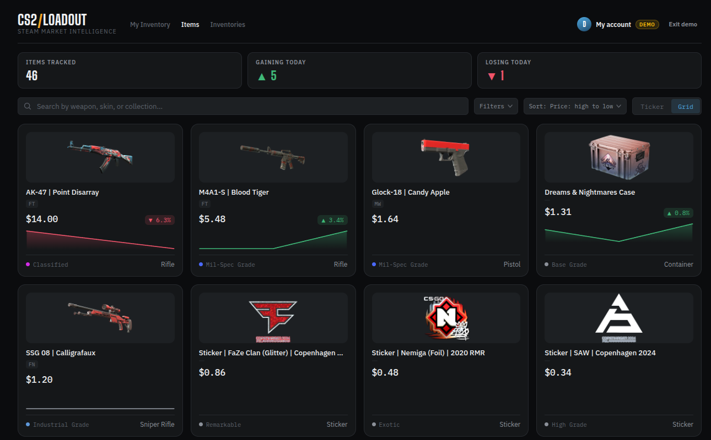
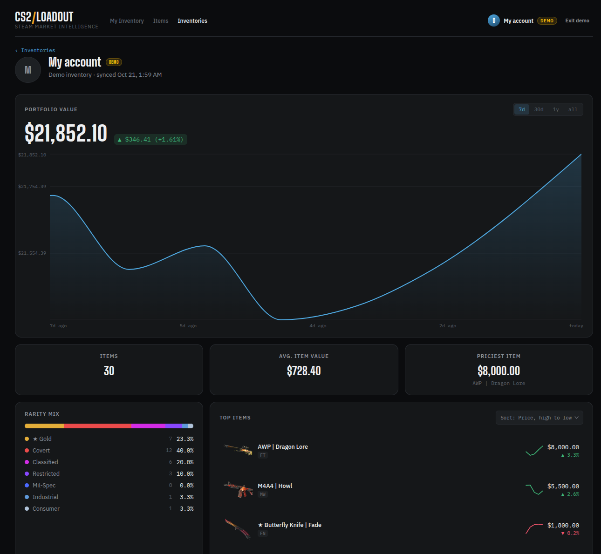
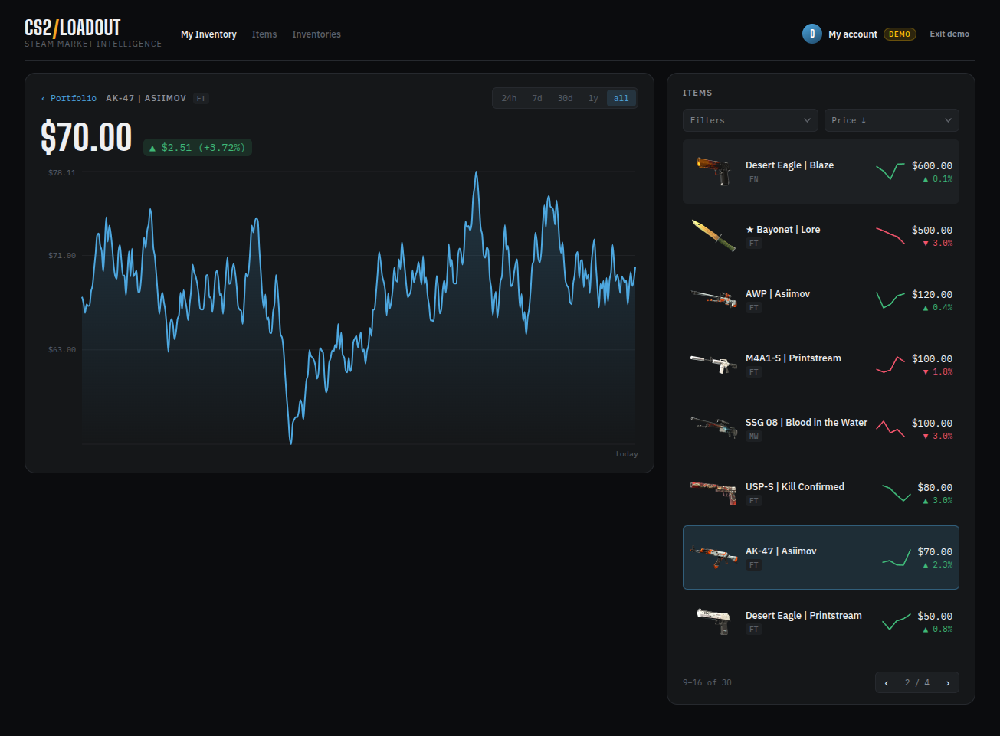
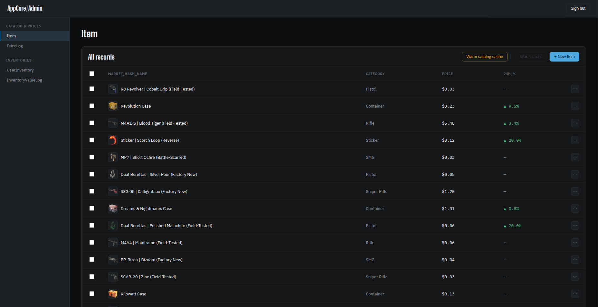

# CS2 Loadout

**Track what your CS2 inventory is worth — and how that value changes over time.**

[](https://github.com/oleg-kovalev-rb/cs2-loadout/actions/workflows/ci.yml)
[](https://codecov.io/gh/oleg-kovalev-rb/cs2-loadout)

[Live app](https://app.cs2-loadout.pro) · [API health](https://api.cs2-loadout.pro/up) · [Try the demo](https://app.cs2-loadout.pro) (no Steam account needed)



CS2 Loadout signs you in through Steam, reads your public CS2 inventory, and
turns it into a portfolio: current value, daily value history, per-item price
charts, and a searchable item catalog. Prices refresh hourly in the background;
portfolio snapshots are written nightly into a time series.

## Features

- **Steam sign-in** — Steam OpenID, public inventory only; nothing is ever
  posted on the user's behalf.
- **Portfolio dashboard** — current value, change over 7d/30d/1y/all, daily
  snapshots, and per-item sparklines.
- **Item price history** — a full chart per item with switchable periods
  (24h, 7d, 30d, 1y, all).
- **Item catalog** — public, sign-in-free catalog with search, category and
  rarity filters, a StatTrak filter, sorting, and pagination.
- **Public inventories** — browse every synced inventory with total value,
  24h change, and rarity mix, plus a per-player detail page.
- **Demo mode** — a read-only portfolio with fixed data that expires after
  12 hours.
- **Admin panel** — catalog management, price logs, inventory sync, and cache
  warmup.

## Screens

<table>
  <tr>
    <td valign="top">
      <a href="docs/images/tracked-items.png"></a><br>
      <sub>Item catalog</sub>
    </td>
    <td valign="top">
      <a href="docs/images/inventory-detail.png"></a><br>
      <sub>Public inventory detail</sub>
    </td>
  </tr>
  <tr>
    <td valign="top">
      <a href="docs/images/item-history.png"></a><br>
      <sub>Item price history</sub>
    </td>
    <td valign="top">
      <a href="docs/images/admin-panel.png"></a><br>
      <sub>Admin panel</sub>
    </td>
  </tr>
</table>

## Architecture

```
                        Steam OpenID
 Browser ─────────────────────────────────▶ app_core  (Rails + React islands)
    │                                           │
    │  page embeds a bridge token               │ Postgres: users, sessions
    │  and the public fetcher URL               │
    │                                           ▼
    └───────────── direct API calls ─────▶ app_fetcher  (Rails API)
                    (bridge token)              │
                                                ├── Postgres: items, prices,
                                                │   inventories, value snapshots
                                                ├── Redis: caches, Sidekiq queues,
                                                │   demo sessions
                                                └── Sidekiq + sidekiq-cron
                                                        │
                                                        ▼
                                                Steam Store / Market APIs
```

Two Rails applications, deliberately separated:

- **`app_core` owns identity and pages.** It handles Steam OpenID and admin
  login, and renders the dashboard shell with React islands.
- **`app_fetcher` owns data.** It talks to Steam, stores items, prices, and
  inventories, and serves JSON to players, the public catalog, demo sessions,
  and admins.

The browser calls `app_fetcher` directly. `app_core` does not proxy API traffic:
it embeds a bridge token and the fetcher's public URL into the page; the browser
presents that token on every API call. CORS on the fetcher allows only
`APP_CORE_ORIGIN`. Player, admin, and demo tokens are signed with three different
secrets, so one kind can never pass as another.

Background work runs in `app_fetcher` through Sidekiq:

- hourly refreshes of stale item prices across the catalog;
- nightly portfolio value snapshots per user;
- a daily scheduler that syncs each user's inventory roughly once a week.

Each app has its own Postgres database. Redis is shared and holds caches,
Sidekiq queues, and demo sessions.

## Tech stack

| Area | Stack |
|---|---|
| Backend | Ruby 3.3, Rails 7.2 (`app_fetcher` is API-only), Sorbet |
| Frontend | React 19 islands built with Vite, Turbo + Stimulus |
| Data | PostgreSQL 15 (one database per app), Redis 7 |
| Background | Sidekiq 8 with sidekiq-cron |
| Tests | RSpec, FactoryBot, WebMock/VCR, Vitest + Testing Library |
| Delivery | Docker Compose, GitHub Actions, Kamal, Codecov |

## Repository layout

| Path | Contents |
|---|---|
| `app_core/` | User-facing Rails app: Steam login, dashboard, inventories, item catalog, admin panel |
| `app_fetcher/` | API-only Rails service: Steam ingestion, pricing jobs, JSON APIs |
| `agent/` | ADRs, styleguides, the user story, and development plans |
| `script/` | Deploy script and git-hook wrappers |
| `docker-compose.yml` | Local stack: two Postgres databases, Redis, both apps, and Sidekiq |
| `.github/workflows/` | CI and deploy pipelines |

## Running locally

### Prerequisites

Docker with Compose. Ruby and Node are not required on the host.

### Setup

```bash
cp .env.example .env

# Generate the three JWT secrets with: openssl rand -hex 32
# Then set the two local URLs in .env:
#   APP_FETCHER_PUBLIC_URL=http://localhost:3001
#   APP_CORE_ORIGIN=http://localhost:3000

docker compose up -d db_core db_fetcher redis
docker compose run --rm app_fetcher bin/rails db:prepare
docker compose run --rm app_core bin/rails db:prepare
docker compose up
```

| Variable | Local value |
|---|---|
| `APP_FETCHER_PUBLIC_URL` | `http://localhost:3001` |
| `APP_CORE_ORIGIN` | `http://localhost:3000` |
| `APP_BRIDGE_JWT_SECRET` | `openssl rand -hex 32` |
| `APP_ADMIN_BRIDGE_JWT_SECRET` | `openssl rand -hex 32` |
| `APP_DEMO_JWT_SECRET` | `openssl rand -hex 32` |
| `STEAM_WEB_API_KEY` | Optional; fetches the real Steam nickname and avatar |

Open <http://localhost:3000> and choose **Try a demo account** — the demo works
without a Steam API key. The API health check is at <http://localhost:3001/up>.
Vite compiles assets on demand in development, so the first page load is slower.
If you leave `STEAM_WEB_API_KEY` blank, sign-in still works; the dashboard falls
back to a generic nickname and avatar.

For the full environment contract (production values, secrets, first deploy),
see [`agent/styleguides/deployment.md`](agent/styleguides/deployment.md).

### Tests and checks

Prepare the test databases once, then run the suites:

```bash
docker compose exec app_fetcher bin/rails db:test:prepare
docker compose exec app_core bin/rails db:test:prepare

docker compose exec app_core bin/ci
docker compose exec app_fetcher bin/ci
```

`bin/ci` is the local equivalent of the GitHub Actions pipeline: RuboCop,
Sorbet, bundler-audit, Brakeman, RSpec, and a seeds check, plus
ESLint/Prettier/Vitest in `app_core`.

Git hooks are installed by running `npm install` at the repository root
(Lefthook). CI runs on every pull request and on pushes to `main`; a green run
on `main` triggers deployment.

## Documentation

The repository keeps its engineering docs in `agent/`:

| Path | Contents |
|---|---|
| `agent/adr/` | Architecture Decision Records, shared and per app |
| `agent/styleguides/` | Conventions for Ruby, tests, layering, deployment, and CI |
| `agent/US/` | The end-to-end dashboard user story |
| `agent/plans/` | Development plans and their status |
| `AGENTS.md` | How AI agents work in this repository |

Start with
[`agent/US/dashboard-user-story.md`](agent/US/dashboard-user-story.md) for the
end-to-end flow, and
[`agent/styleguides/README.md`](agent/styleguides/README.md) for the conventions
index.

## Deployment

Production runs on a single VPS with Kamal: two services (`steam-core` and
`steam-fetcher`), a shared `kamal-proxy`, and Postgres/Redis accessories. Deploys
are performed by GitHub Actions after a successful CI run on `main`, with
`app_fetcher` shipping before `app_core`. See
[`agent/styleguides/deployment.md`](agent/styleguides/deployment.md) for setup,
secrets, and rollback.

## Limitations

- Prices update hourly, not in real time, and there is no push channel to open
  dashboards.
- Inventory composition syncs on first visit and then roughly weekly.
- The demo uses a fixed dataset and is read-only.
- The production topology is a single VPS without high availability.
